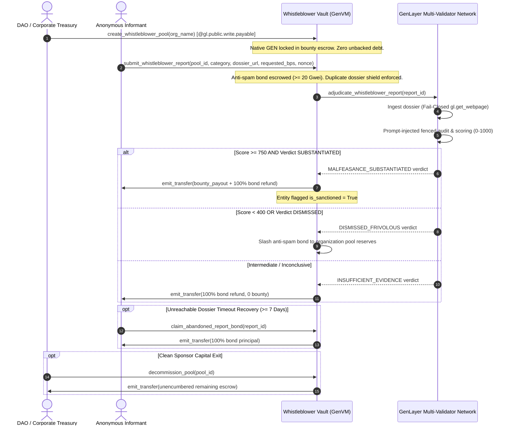

# Autonomous Whistleblower Protection Vault (AWPV)
> **Decentralized Corporate Governance & DAO Malfeasance Whistleblower Escrow with Multi-Validator Dossier Adjudication on GenLayer**

[](https://genlayer.com)
[](https://opensource.org/licenses/MIT)
[](test/test_autonomous_whistleblower_vault.py)
[](https://github.com/tumhi4)

The **Autonomous Whistleblower Protection Vault** is an immutable, sovereign governance primitive engineered to resolve the catastrophic incentive misalignment in corporate and DAO whistleblowing: internal whistleblowers fearing career destruction, blacklisting, or leaked identities, and organizations fearing frivolous extortion or unverified smear campaigns.

---

## 1. Verified GenLayer Studio Testnet Deployment

| Parameter | On-Chain Value |
| :--- | :--- |
| **Protocol Name** | `AutonomousWhistleblowerProtectionVault` |
| **Contract Address** | [`0xA47E3C057f48Ef5B37710831897603DC4C0fD036`](https://explorer-studio.genlayer.com/address/0xA47E3C057f48Ef5B37710831897603DC4C0fD036) |
| **Deployment Transaction** | `0xe0fab90ed71384889549b329d0d168eb273384e1fa728ef5254e0bfa1ef82dbf` |
| **Receipt Status** | `7` (`FINALIZED`) |
| **Studio RPC** | `https://studio.genlayer.com/api` |
| **Target Repository** | [https://github.com/tumhi4/autonomous-whistleblower-protection-vault](https://github.com/tumhi4/autonomous-whistleblower-protection-vault) |
| **Genesis Escrow Obligation** | `0` Wei (100% Backed, Zero Unbacked Genesis Liabilities) |

---

## 2. System Architecture & Lifecycle



---

## 3. Core Technical Invariants & Steward Compliance

1. **100% Backed Payable Escrow**: Pool reserves, top-ups, and anti-spam bonds require native GEN strictly via `@gl.public.write.payable` reading `gl.message.value`.
2. **Duplicate Dossier Shield**: Tracks canonical `pool_id + dossier_url` hashes to prevent copycats and mempool front-running bounty drains.
3. **Strict Metric Binding**: Bounties require proof score $\ge 750$ and explicit consensus verification; frivolous reports ($< 400$) slash anti-spam bonds.
4. **Dossier Timeout Bond Recovery**: If an external leak site goes offline permanently, whistleblowers can recover their bond principal after 7 days via `claim_abandoned_report_bond()`.
5. **Prompt Injection Hardening**: External web payloads are boundary-boxed inside `<untrusted_evidence_dossier>` tags with strict system directives.
6. **Controlled Sponsor Exit**: Unsanctioned organizations can decommission pools and reclaim unencumbered capital via `decommission_pool()`.
7. **Recoverable Claimable Balances**: Failed EVM transfers credit to `claimable_balances`, safely recoverable via `withdraw_claimable()`.

---

## 4. Verification & Testing

The contract has been audited through a 15-phase Python regression test suite covering all operational edge cases:

```bash
python test/test_autonomous_whistleblower_vault.py
```

```
================================================================================
ALL 15 PHASES OF AutonomousWhistleblowerProtectionVault (REMEDIATED) PASSED WITH 0 ERRORS!
================================================================================
```

---

## 5. License

MIT License. Designed and deployed for GenLayer by [tumhi4](https://github.com/tumhi4).
